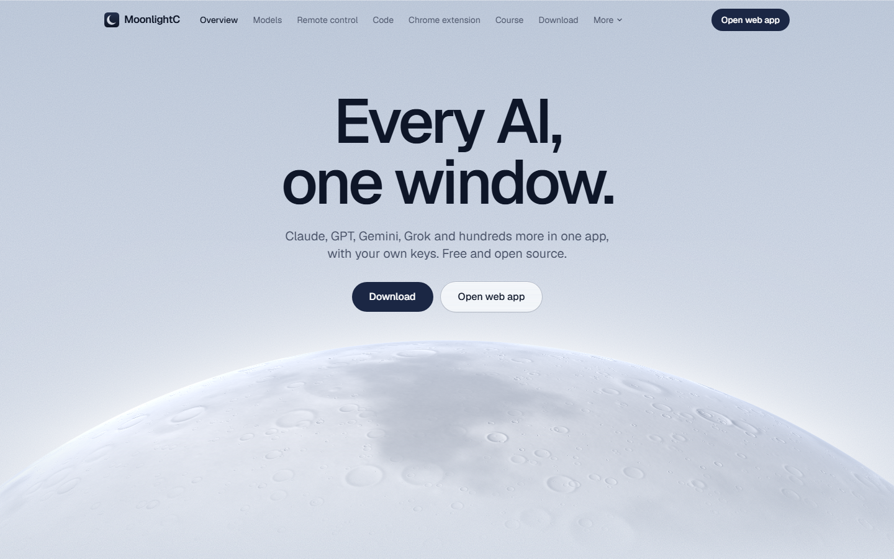
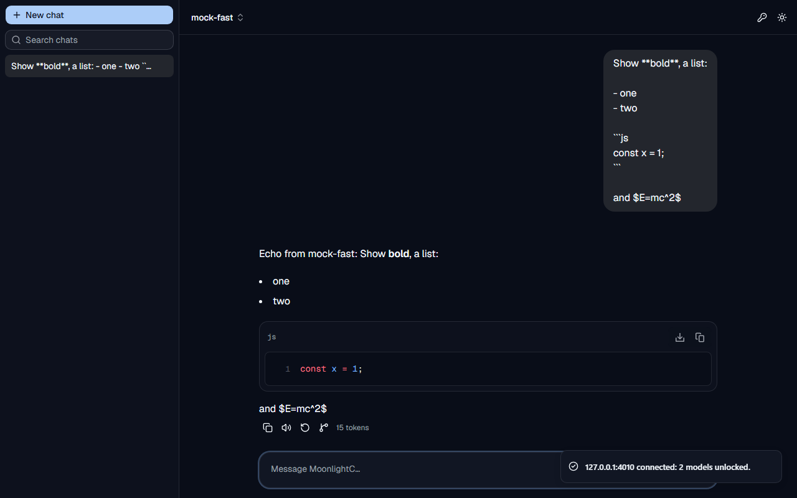
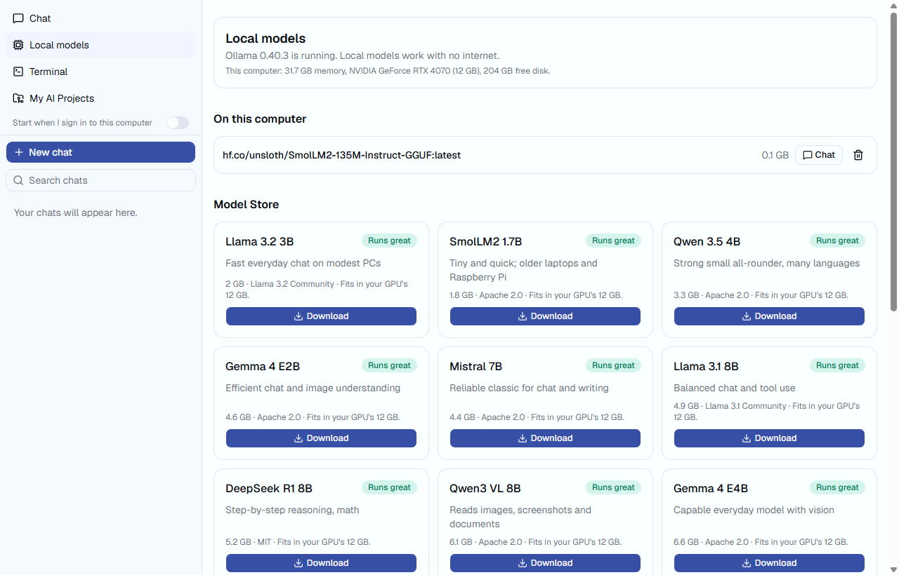
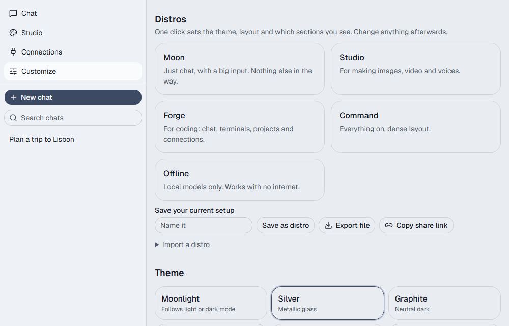

# MoonlightC

Every AI in one place: cloud models, local models, creative tools and your own computers.
Free and open source (MIT). Bring your own keys; nothing is resold and there are no caps from us.



## What it does
- **Chat with any model**: Anthropic, OpenAI, Google, xAI, Mistral, DeepSeek, Groq, Together, Perplexity, Cohere,
  OpenRouter or any OpenAI-compatible server. Model lists come live from each provider. Switch models mid-chat, or let
  **Auto** pick per message (each reply says which model it chose and why).
- **Free AI built in**: Free rotates through every free model at eleven companies with free plans; a model at its limit
  rests and the next one answers.
- **Commands**: type `/` and a plain word (`/translate spanish good morning`, `/summarize`, `/model claude`), or make your
  own with `{input}` where your text goes.
- **Everyday tools**: projects, opt-in memory you can edit, private chats, branching, search across every message,
  export and ChatGPT/Claude import, attachments, voice, web search and Python, Deep Research, 12 ready-made modes,
  a memory meter with "continue in a new chat", and a monthly budget.
- **Make things**: apps that run beside the chat; a Code workspace with live preview, undo, **Fix it** for errors,
  GitHub publishing and Vercel deploys; a Studio for images, video and voices with **Improve prompt** and **Compare models**.
- **Connect your stuff**: any MCP server plus one-click Notion, Linear, Vercel, Supabase, Stripe and more, GitHub,
  Google, Slack, Spotify, Claude plugins and a mods SDK. Every tool asks before it acts.
- **Your PC and browser**: the desktop app (Windows, macOS, Linux) adds local models, Claude Code with your own plan,
  terminals in your real folders, and **remote control** of your PC from your phone (two-step sign-in, approval on the PC).
  The Chrome extension lets the AI read and act in tabs you share, and waits for your OK on risky steps.
- **Make it yours**: Appearance in three levels (Simple, More, Full control) with live previews of every theme, fonts,
  text size, chat width, backgrounds, layouts and shortcuts. Nothing sticks until you click Save.
- **Learn it**: a free course on the website, from your first chat to putting your own site online.

| Chat | Local models | Customize |
|---|---|---|
|  |  |  |

## Use it
- Web: https://moonlightc.vercel.app
- Desktop: https://moonlightc.vercel.app/download
- Course: https://moonlightc.vercel.app/course

## Develop
```bash
pnpm install
pnpm dev                                   # web app on http://localhost:3000
pnpm build && pnpm --filter @moonc/web e2e # end-to-end tests (mock AI provider included)
pnpm --filter @moonc/desktop bundle-web && pnpm --filter @moonc/desktop dev   # desktop app
```

Layout: `apps/web` (Next.js site + app + API), `apps/desktop` (Electron), `packages/core` (providers),
`packages/mods-sdk` (mod manifest + sandbox protocol). See [CONTRIBUTING.md](CONTRIBUTING.md) and
[docs/MODDING.md](docs/MODDING.md).
