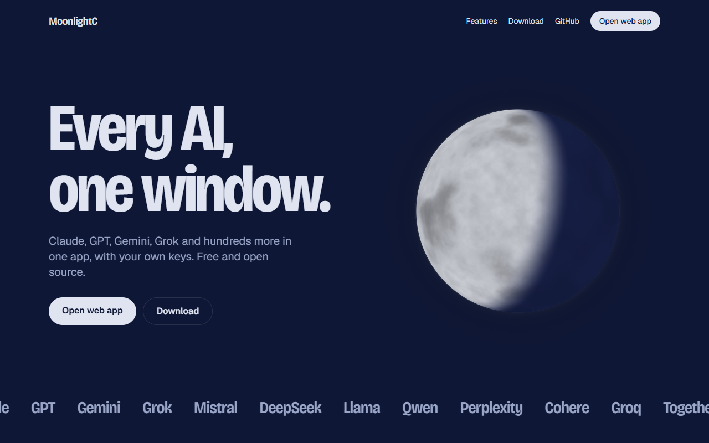
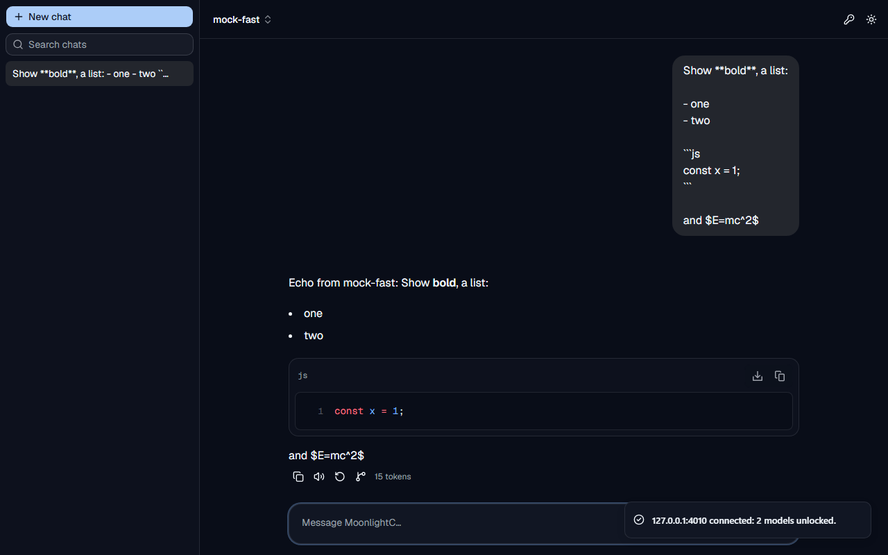
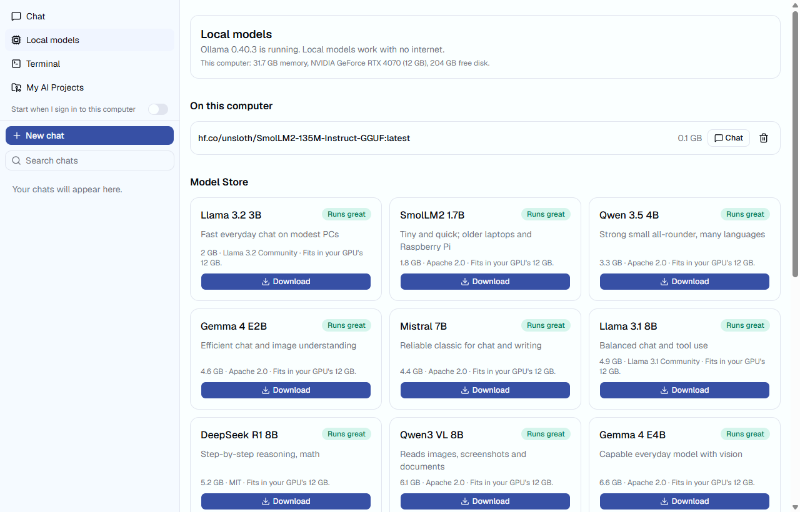
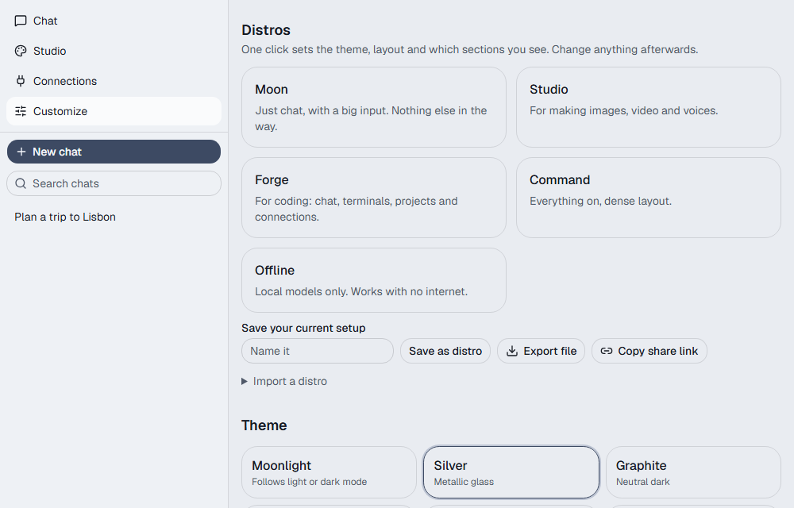

# MoonlightC

Every AI in one place: cloud models, local models, creative tools and your own computers.
Free and open source (MIT). Bring your own keys; nothing is resold and there are no caps from us.



## What it does
- **Chat with any model**: Anthropic, OpenAI, Google, xAI, Mistral, DeepSeek, Groq, Together, Perplexity, Cohere,
  OpenRouter or any OpenAI-compatible server. Model lists come live from each provider. Stop, edit, regenerate, branch,
  compare 2–4 models side by side, attachments, artifacts (live HTML/SVG/React), Python in the browser, web search,
  Deep Research, voice typing, modes and a Private mode that saves nothing.
- **Studio**: images, video and voices with your fal, OpenAI, Google, xAI, Replicate or ElevenLabs keys.
- **Connections**: any MCP server, with per-tool "ask / always / never" permissions. GitHub with a live stats dashboard.
- **Desktop app** (Windows, macOS, Linux): local models through Ollama with a Model Store that says whether a model will
  run on your PC, real terminals with one-click Claude Code / Codex / Gemini CLI / Aider, and My AI Projects.
- **Customize**: distros, themes and a theme editor, layout options, rebindable shortcuts, and mods.

| Chat | Local models | Customize |
|---|---|---|
|  |  |  |

## Use it
- Web: https://moonlightc.vercel.app
- Desktop: https://moonlightc.vercel.app/download

## Develop
```bash
pnpm install
pnpm dev                                   # web app on http://localhost:3000
pnpm build && pnpm --filter @moonc/web e2e # end-to-end tests (mock AI provider included)
pnpm --filter @moonc/desktop bundle-web && pnpm --filter @moonc/desktop dev   # desktop app
```

Layout: `apps/web` (Next.js site + app + API), `apps/desktop` (Electron), `packages/core` (providers),
`packages/mods-sdk` (mod manifest + sandbox protocol). See [CONTRIBUTING.md](CONTRIBUTING.md) and
[docs/MODDING.md](docs/MODDING.md).
